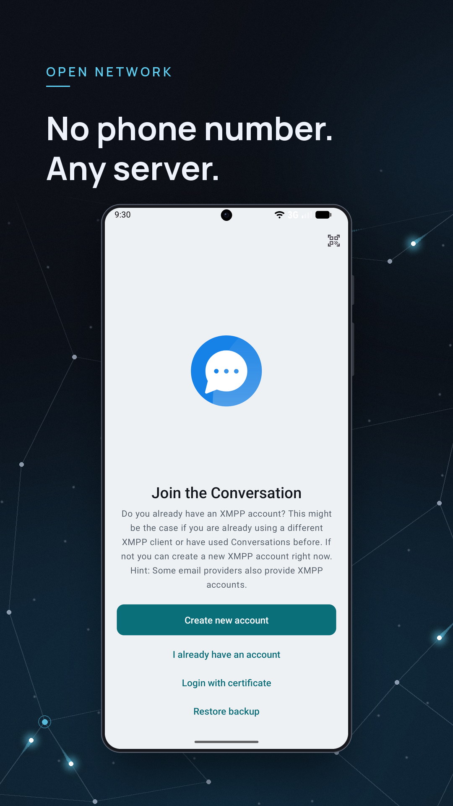
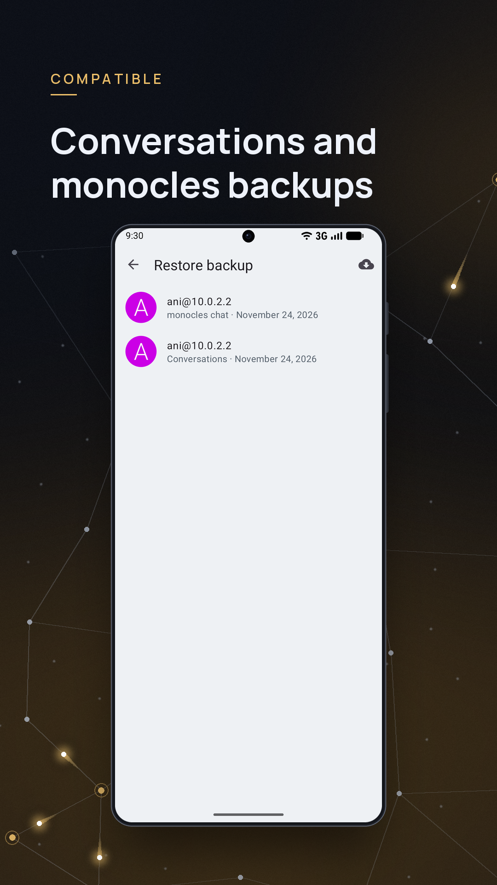

#  Tatrak

**An Android messenger for the open XMPP network, with encrypted local storage and a modern interface.**

[](https://github.com/CyberHayq/Tatrak/releases)
[](LICENSE)
[](knowledge/build/build-setup.md)

Tatrak brings a familiar, Telegram-style experience to the open XMPP network. Your message history
and media are stored encrypted on your phone, and your chats are protected by established OMEMO
and OpenPGP end-to-end encryption.

[Download](https://github.com/CyberHayq/Tatrak/releases) ·
[Get started](#-get-started) · [Features](#-features) · [Security](#-security) ·
[Build](#-building-from-source) · [Report an issue](https://github.com/CyberHayq/Tatrak/issues)

<p align="center">
  
  
  
</p>
<p align="center">
  
  
  
</p>

## 🎯 Our goals

- 🙂 **XMPP for everyone.** Messaging on the open XMPP network should feel as simple as any
  popular messenger: no jargon and no manual setup to get started.
- 🧰 **Nothing taken from advanced users.** Power features stay, and it becomes easy to bring
  friends and family over.
- 🔐 **Secure by default.** End-to-end encryption and encrypted local storage are on from the
  start, not options to find.
- 🤝 **Compatible.** Standard XMPP, any server, and conversations with people on other clients,
  as far as the protocol allows.

These are the directions we work in; the [development status](#-development-status) shows how far
each one has come.

## 🤔 Why XMPP

XMPP is an open standard for messaging, run by many independent providers that talk to each other,
much like email. No single company owns the network, and you can move to another provider or run
your own server.

|  | **Tatrak (XMPP)** | **Telegram** | **WhatsApp** | **Signal** |
|---|:---:|:---:|:---:|:---:|
| Sign up without a phone number | ✅ | ❌ | ❌ | ❌ |
| Not run by a single company | ✅ | ❌ | ❌ | ❌ |
| Run your own server or pick a provider | ✅ | ❌ | ❌ | ❌ |
| End-to-end encryption by default | ✅ ¹ | ❌ ² | ✅ | ✅ |
| Open-source app | ✅ | ✅ | ❌ | ✅ |

¹ For one-to-one chats and private groups when the other person's app supports OMEMO; public group
chats are not end-to-end encrypted.
² Only "secret chats", which are one-to-one and not the default.

## ✨ Features

- 🔒 **Encrypted local storage.** Message history is stored in a SQLCipher database. Attachments,
  voice messages, camera captures, avatars, wallpapers and sticker packs are stored encrypted.
- 🛡️ **End-to-end encryption.** OMEMO and OpenPGP.
- 💬 **Organised conversations.** Built-in All, Personal, Groups and Unread folders, with archive,
  pin, mute and actions for several chats at once.
- 🎙️ **Voice and media.** Hold-to-record voice messages, an attachment sheet and an emoji panel.
  On Android 10 and newer, voice messages are encrypted during recording without being written
  to disk in plaintext.
- 🎨 **Personalisation.** Light and dark themes, accent colours and chat wallpapers.
- 🌐 **Multiple accounts and group chats.** Connect to a standard XMPP provider or host your own
  server, and communicate with people on other servers.
- 🔔 **UnifiedPush notifications.** Push notification support without a Google account.

Replies, reactions, message editing, delete for everyone, sticker packs, conversation search,
audio and video calls, and backups are implemented with validation still in progress. See the
[development status](#-development-status) below for details. Feature availability also depends
on your XMPP server and the clients used by other participants.

## 🚀 Get started

1. **Install Tatrak.** Download the APK from [GitHub Releases](#-download).
2. **Get an XMPP address.** Sign in with an address you already have, or create one at a public
   provider: [providers.xmpp.net](https://providers.xmpp.net) lists providers and rates how well
   they suit new users. You can also run your own server.
3. **Add your friends.** Share your address (it looks like an email address, `name@provider`) or an
   invite link, see below.

## 👋 Bring your friends

- **Invite links.** If your provider supports invitations, the side menu offers "Invite to
  server": your friend gets a link that sets up an account and adds you as a contact.
- **Any XMPP app works.** Your friends do not need Tatrak: other platforms have their own XMPP
  apps, for example Monal on iPhone, and Gajim or Dino on the desktop.
- **No phone number to share.** People reach you by your XMPP address only.

## 📥 Download

Download release APKs from [GitHub Releases](https://github.com/CyberHayq/Tatrak/releases).
Tatrak requires **Android 8.0 or newer**. If you are unsure which APK to take, `arm64-v8a` fits
almost every current phone and `universal` fits all of them. Releases marked as pre-releases are
for testing.

You will need an XMPP account to use Tatrak. Choose an XMPP provider or use your own server.

### Verify an APK

The release signing certificate has the following SHA-256 fingerprint:

```text
3bae017d66664f88502ab51a6868621c1f93fd47004b3666796d3cd9a6946d9b
```

Use `apksigner` from the Android SDK Build Tools to inspect a downloaded APK:

```sh
apksigner verify --print-certs <apk>
```

Compare the reported certificate SHA-256 digest with the fingerprint above. Release APKs are
reproducible and signed with one key; the build process is documented in the
[build setup](knowledge/build/build-setup.md). Tatrak is not on F-Droid yet.

## 🔐 Security

### Messages in transit

End-to-end encryption uses OMEMO and OpenPGP; connections use TLS, SASL and DNSSEC. This
protocol and encryption code is taken unchanged from a long-established XMPP client; Tatrak's
interface only calls it.

### Data on your phone

The message database is encrypted with SQLCipher, and local media is stored encrypted.
Encryption keys are randomly generated and protected by the Android Keystore.

### 🛡️ What Tatrak protects, and what it does not

| Protected | Not protected |
|---|---|
| Message content from your provider and the network, in end-to-end encrypted chats | Your contact list, who you talk to and when: your provider sees this metadata |
| Your history and media at rest, if someone gets the phone's storage | Anyone who uses your unlocked phone: there is no app lock yet |
| Connections to your provider (TLS) | Public group chats and contacts whose apps do not support OMEMO |

### Audits and supply chain

- The encryption code Tatrak builds on was audited by Radically Open Security: an OMEMO analysis
  in [2016](https://conversations.im/omemo/audit.pdf) and a penetration test of the app it comes
  from in [2025](https://conversations.im/2025_audit_conversations.pdf). Tatrak's own code (local
  encryption, the new interface) has not been independently audited.
- No Google Play services and no known proprietary or tracking libraries: the source and the APK
  pass F-Droid's scanner.
- Release APKs build reproducibly from the public source.

Read more about [database encryption](knowledge/build/local-db-encryption.md) and
[attachment encryption](knowledge/protocol/attachment-encryption.md).

## 📊 Development status

Tatrak is under active development. **Verified** means implemented and checked on emulators;
**In testing** means implemented with validation still open. Broad testing on physical devices
is still pending. Planned features have no committed release dates.

| Feature | Status |
|---|---|
| Encrypted message database on the device (SQLCipher) | ✅ Verified |
| Encrypted storage for attachments, voice messages, avatars, wallpapers and sticker packs | ✅ Verified |
| Voice messages encrypted while you record, never written to disk in the clear (Android 10+) | ✅ Verified |
| Chat folders (All, Personal, Groups, Unread), archive, pin, mute, select several chats | ✅ Verified |
| Chat screen, light and dark themes, accent colours and chat wallpapers | ✅ Verified |
| Hold-to-record voice messages, attachment sheet, emoji panel | ✅ Verified |
| Replies, reactions, editing, delete for everyone, sticker packs, search across conversations | 🧪 In testing |
| Encrypted audio and video calls, call list | 🧪 In testing |
| Backups, including import of monocles chat backups | 🧪 In testing |
| Select several messages in a chat; chat preview on a long press of its avatar that opens into the chat as in Telegram | 🧪 In testing |
| Account switcher: show the whole app for one account, disabled accounts included | 🧪 In testing |
| Frequently used reactions in the message menu | 🧪 In testing |
| Updates from GitHub releases inside the app (beta versions optional), release signature checked | 🧪 In testing |
| Private messages to a group participant from the chat (text and replies) | 🧪 In testing |
| App language chosen in the settings, on every Android version | 🧪 In testing |
| "Saved messages" always in the side menu and the Profile tab, pinned for every new account | 🧪 In testing |
| Voice messages keep playing outside the chat and in the background: a mini bar, a notification and the system media controls | 🧪 In testing |

### 🗺️ Roadmap

| Feature | Status |
|---|---|
| Simple sign-up: a provider suggested for you, no jargon on the way | 🗓️ Planned |
| "Invite a friend" where people look for it: contacts and profile, not only the side menu | 🗓️ Planned |
| Plain words on the main screens ("address" instead of "JID") | 🗓️ Planned |
| A clear warning before a message goes out without end-to-end encryption | 🗓️ Planned |
| App lock (PIN or biometric) | 🗓️ Planned |
| Password mode for local encryption | 🗓️ Planned |
| Camera button during a voice call | 🗓️ Planned |
| OMEMO 2 | 🗓️ Planned |
| Group calls | ❓ Under assessment |
| Post-quantum OMEMO | ❓ Under assessment |

For implementation notes and planned work, see the [roadmap](knowledge/project/roadmap.md).

## 🔧 Building from source

### Requirements

- JDK 25.
- Android SDK with compile SDK 37 and Build Tools 36.0.0.
- Accepted Android SDK licences and a configured SDK path (`ANDROID_HOME` or `local.properties`).

Use the Gradle wrapper included in the repository:

```sh
# Build an installable debug APK.
./gradlew assembleConversationsFreeDebug

# Run unit and Robolectric/Roborazzi screenshot tests.
./gradlew testConversationsFreeDebugUnitTest

# Build release APKs; unsigned unless signing.properties is configured.
./gradlew assembleConversationsFreeRelease
```

APKs are written to `build/outputs/apk/conversationsFree/`. The `conversationsFree` variant is
Tatrak; the upstream `quicksy` flavour is retained to simplify upstream merges and is not shipped.
The upstream `playstore` flavour is switched off until Tatrak is published on Google Play (its
sources stay in `src/*playstore*`; they need a `google-services.json`).

See the [build setup](knowledge/build/build-setup.md) for signing and reproducible release builds.

The [Appium regression suite](tools/qa/README.md) includes nine regression cases and three
smoke cases. Run its commands from `tools/qa/`; device checks require explicit opt-in.
See the [recorded results](tools/qa/RUN_RESULTS.md) for the tested APK and coverage limits.

## 💬 Support and contributions

Report bugs and suggest improvements through the
[issue tracker](https://github.com/CyberHayq/Tatrak/issues). For bug reports, include your Tatrak
version, Android version, device model, steps to reproduce, and the expected and actual behaviour.
Remove personal information from any logs or screenshots before sharing them.

Before starting a substantial contribution, open an issue to discuss the scope. Project design,
architecture and development guidance live in [`knowledge/`](knowledge/), starting with the
[project overview](knowledge/project/overview.md).
A source-based [comparison with other messengers](docs/messenger-comparison.md) is also available.

Tatrak is available in English, Russian and Armenian (Soviet and traditional orthography); more
languages are welcome.

## 🙏 Credits and licence

Tatrak is built on [Conversations](https://codeberg.org/iNPUTmice/Conversations) by Daniel Gultsch
and contributors. Parts of the chat list animations are ported from
[Telegram for Android](https://github.com/DrKLO/Telegram), licensed under GNU GPL v2 or later.

Tatrak is free software licensed under the [GNU General Public License v3](LICENSE).
