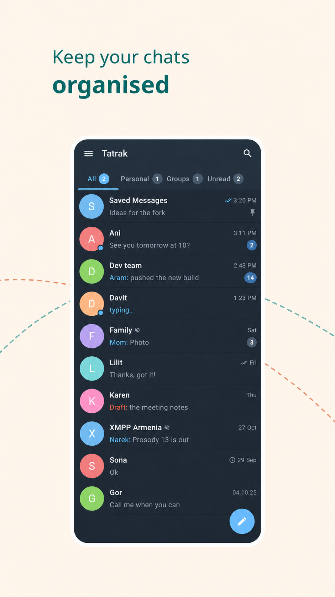
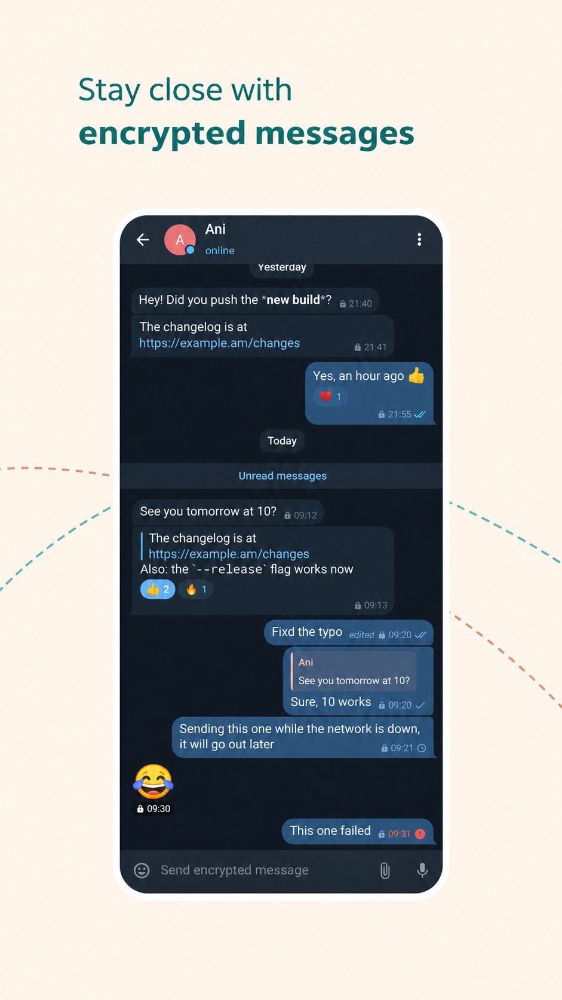
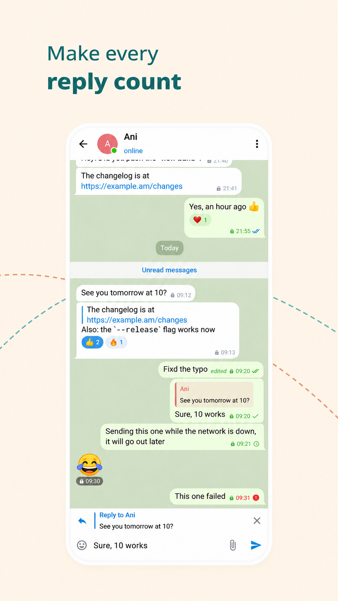
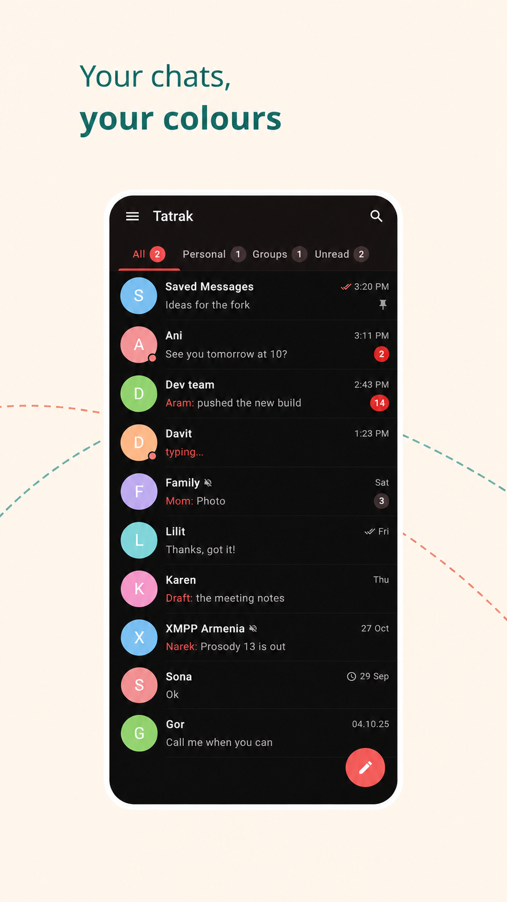

#  Tatrak

**An Android messenger for the open XMPP network, with encrypted local storage and a modern interface.**

Tatrak combines a familiar, Telegram-style experience with the messaging foundation of
[Conversations](https://codeberg.org/iNPUTmice/Conversations). Your message history and media are
stored encrypted on your phone, while Conversations' OMEMO and OpenPGP end-to-end encryption
remains unchanged.

[Download](https://github.com/CyberHayq/Tatrak/releases) ·
[Features](#features) · [Security](#security) · [Build](#building-from-source) ·
[Report an issue](https://github.com/CyberHayq/Tatrak/issues)

<p align="center">
  
  
  
  
</p>

## Features

- **Encrypted local storage.** Message history is stored in a SQLCipher database. Attachments,
  voice messages, camera captures, avatars, wallpapers and sticker packs are stored encrypted.
- **End-to-end encryption.** OMEMO and OpenPGP support inherited from Conversations.
- **Organised conversations.** Built-in All, Personal, Groups and Unread folders, with archive,
  pin, mute and actions for several chats at once.
- **Voice and media.** Hold-to-record voice messages, an attachment sheet and an emoji panel.
  On Android 10 and newer, voice messages are encrypted during recording without being written
  to disk in plaintext.
- **Personalisation.** Light and dark themes, accent colours and chat wallpapers.
- **Multiple accounts and group chats.** Connect to a standard XMPP provider or host your own
  server, and communicate with people on other servers.
- **UnifiedPush notifications.** Push notification support without a Google account.

Replies, reactions, message editing, delete for everyone, sticker packs, conversation search,
audio and video calls, and backups are implemented with validation still in progress. See the
[development status](#development-status) below for details. Feature availability also depends
on your XMPP server and the clients used by other participants.

## Download

Download release APKs from [GitHub Releases](https://github.com/CyberHayq/Tatrak/releases).
Tatrak requires **Android 8.0 or newer**. If you are unsure which APK to take, `arm64-v8a` fits
almost every current phone and `universal` fits all of them. Releases marked as pre-releases are
for testing.

You will need an XMPP account to use Tatrak. Choose an XMPP provider or use your own server.

### Verify an APK

The release signing certificate has the following SHA-256 fingerprint:

```text
3bae017d66664f88502ab51a6868621c1f93fd47004b3666796d3cd9a6946d9b
```

Use `apksigner` from the Android SDK Build Tools to inspect a downloaded APK:

```sh
apksigner verify --print-certs <apk>
```

Compare the reported certificate SHA-256 digest with the fingerprint above. Release APKs are
reproducible and signed with one key; the build process is documented in the
[build setup](knowledge/build/build-setup.md). Tatrak is not on F-Droid yet.

## Security

### Messages in transit

Tatrak inherits Conversations' OMEMO and OpenPGP end-to-end encryption, along with its TLS,
SASL and DNSSEC support. The interface uses the existing protocol and encryption APIs.

### Data on your phone

The message database is encrypted with SQLCipher, and local media is stored encrypted.
Encryption keys are randomly generated and protected by the Android Keystore.

There is no app passcode yet. Local encryption protects stored data; it does not prevent access
through the app when someone has your unlocked phone. The encryption has not been independently
audited.

Read more about [database encryption](knowledge/build/local-db-encryption.md) and
[attachment encryption](knowledge/protocol/attachment-encryption.md).

## Development status

Tatrak is under active development. **Verified** means implemented and checked on emulators;
**In testing** means implemented with validation still open. Broad testing on physical devices
is still pending. Planned features have no committed release dates.

| Feature | Status |
|---|---|
| Encrypted message database on the device (SQLCipher) | Verified |
| Encrypted storage for attachments, voice messages, avatars, wallpapers and sticker packs | Verified |
| Voice messages encrypted while you record, never written to disk in the clear (Android 10+) | Verified |
| Chat folders (All, Personal, Groups, Unread), archive, pin, mute, select several chats | Verified |
| Chat screen, light and dark themes, accent colours and chat wallpapers | Verified |
| Hold-to-record voice messages, attachment sheet, emoji panel | Verified |
| Replies, reactions, editing, delete for everyone, sticker packs, search across conversations | In testing |
| Encrypted audio and video calls, call list | In testing |
| Backups, including import of monocles chat backups | In testing |
| Select several messages in a chat; chat preview on a long press of its avatar | In testing |
| Frequently used reactions in the message menu | In testing |
| Updates from GitHub releases inside the app (beta versions optional), release signature checked | In testing |

### Roadmap

| Feature | Status |
|---|---|
| App lock (PIN or biometric) | Planned |
| Password mode for local encryption | Planned |
| Camera button during a voice call | Planned |
| OMEMO 2 | Planned |
| Group calls | Under assessment |
| Post-quantum OMEMO | Under assessment |

For implementation notes and planned work, see the [roadmap](knowledge/project/roadmap.md).

## Building from source

### Requirements

- JDK 25.
- Android SDK with compile SDK 37 and Build Tools 36.0.0.
- Accepted Android SDK licences and a configured SDK path (`ANDROID_HOME` or `local.properties`).

Use the Gradle wrapper included in the repository:

```sh
# Build an installable debug APK.
./gradlew assembleConversationsFreeDebug

# Run unit and Robolectric/Roborazzi screenshot tests.
./gradlew testConversationsFreeDebugUnitTest

# Build release APKs; unsigned unless signing.properties is configured.
./gradlew assembleConversationsFreeRelease
```

APKs are written to `build/outputs/apk/conversationsFree/`. The `conversationsFree` variant is
Tatrak; the upstream `quicksy` and `playstore` flavours are retained to simplify upstream merges
and are not shipped.

See the [build setup](knowledge/build/build-setup.md) for signing and reproducible release builds.

## Support and contributions

Report bugs and suggest improvements through the
[issue tracker](https://github.com/CyberHayq/Tatrak/issues). For bug reports, include your Tatrak
version, Android version, device model, steps to reproduce, and the expected and actual behaviour.
Remove personal information from any logs or screenshots before sharing them.

Before starting a substantial contribution, open an issue to discuss the scope. Project design,
architecture and development guidance live in [`knowledge/`](knowledge/), starting with the
[project overview](knowledge/project/overview.md).
A source-based [comparison with other messengers](docs/messenger-comparison.md) is also available.

## Credits and licence

Tatrak is built on [Conversations](https://codeberg.org/iNPUTmice/Conversations) by Daniel Gultsch
and contributors. Parts of the chat list animations are ported from
[Telegram for Android](https://github.com/DrKLO/Telegram), licensed under GNU GPL v2 or later.

Tatrak is free software licensed under the [GNU General Public License v3](LICENSE).
