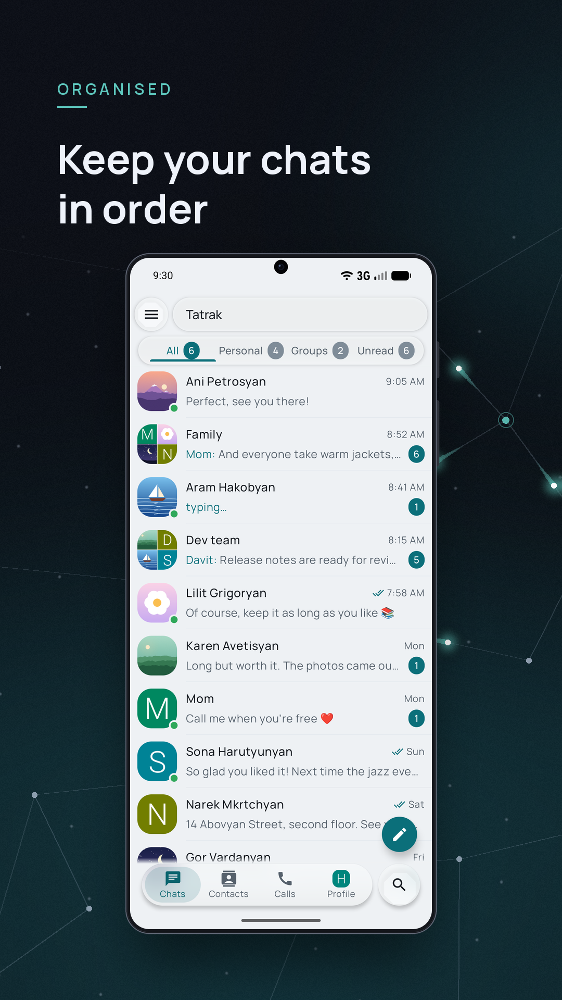
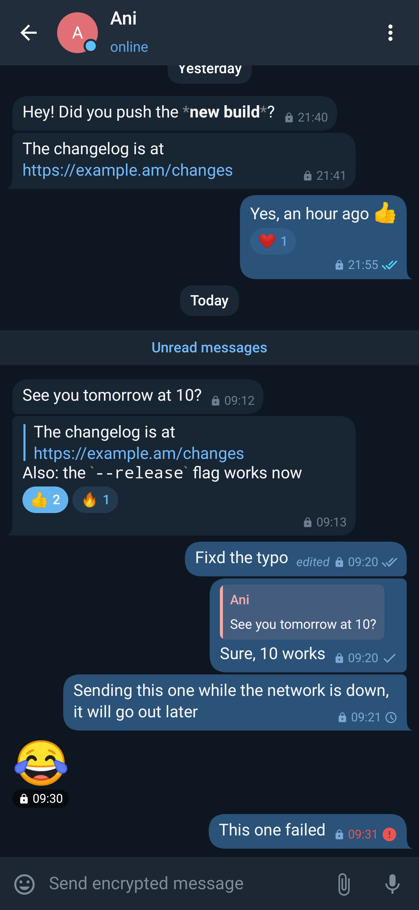
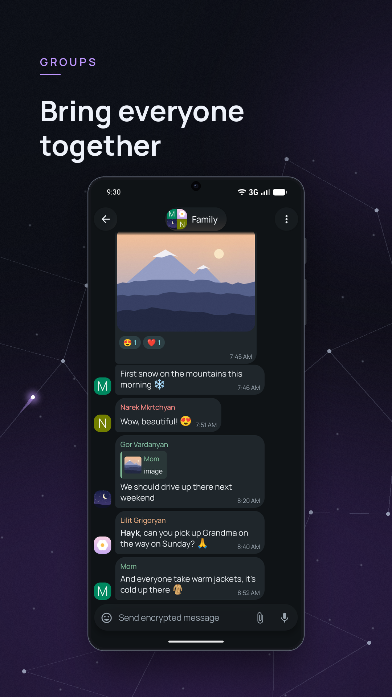
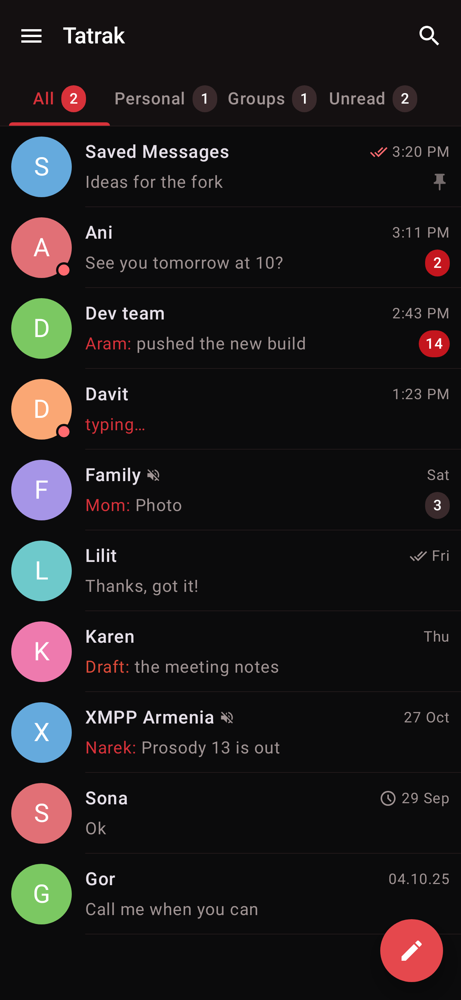

# Tatrak

An Android messenger for the open XMPP network that keeps your data encrypted not only in transit,
but also on the phone: the message history and media files are stored encrypted. Built on
[Conversations](https://codeberg.org/iNPUTmice/Conversations), whose end-to-end encryption it keeps
unchanged.

<p align="center">
  
  
  
  
</p>

## Security

- **In transit:** end-to-end encryption with OMEMO and OpenPGP, TLS, SASL and DNSSEC come from
  Conversations unchanged; Tatrak only builds a new interface on top of them.
- **On the device:** the message database is encrypted with SQLCipher, and attachments, voice
  messages, camera captures, avatars, wallpapers and sticker packs are stored encrypted. The key
  is random and wrapped by the Android Keystore; there is no app passcode yet, so the protection
  is against reading the storage, not against someone holding the unlocked phone.
- The encryption has not been audited by a third party.

Details: [database encryption](knowledge/build/local-db-encryption.md),
[attachment encryption](knowledge/protocol/attachment-encryption.md).

## Features and roadmap

A familiar, Telegram-like interface. ✅ Done: built and checked on emulators. 🧪 In testing:
built, with checks still open. 🗓️ Planned: no dates promised. ❓ Under assessment: not yet
decided. Nothing is tested on a wide range of real phones yet.

| Feature | Status |
|---|---|
| Encrypted message database on the device (SQLCipher) | ✅ Done |
| Encrypted storage for attachments, voice messages, avatars, wallpapers and sticker packs | ✅ Done |
| Voice messages encrypted while you record, never written to disk in the clear (Android 10+) | ✅ Done |
| Chat folders (All, Personal, Groups, Unread), archive, pin, mute, select several chats | ✅ Done |
| Chat screen, light and dark themes, accent colours and chat wallpapers | ✅ Done |
| Hold-to-record voice messages, attachment sheet, emoji panel | ✅ Done |
| Replies, reactions, editing, delete for everyone, sticker packs, search across conversations | 🧪 In testing |
| Encrypted audio and video calls, call list | 🧪 In testing |
| Backups, including import of monocles chat backups | 🧪 In testing |
| App lock (PIN or biometric) | 🗓️ Planned |
| Password mode for local encryption | 🗓️ Planned |
| Select several messages in a chat | 🗓️ Planned |
| OMEMO 2 | 🗓️ Planned |
| Post-quantum OMEMO | ❓ Under assessment |

Several accounts, group chats and push notifications through UnifiedPush (no Google account
needed) come from Conversations. Tatrak works with any standard XMPP server: pick a provider or
run your own, and talk to people on other servers. Available features depend on the server.

## Building

Requires JDK 25 and the Android SDK (compile SDK 37).

```sh
./gradlew assembleConversationsFreeRelease   # unsigned unless signing.properties exists
./gradlew testConversationsFreeDebugUnitTest # unit and screenshot tests
```

APKs land in `build/outputs/apk/conversationsFree/`. `conversationsFree` is the Tatrak build; the
`quicksy` and `playstore` flavours are kept from upstream so upstream merges stay clean, and are
not shipped. More in the [build setup](knowledge/build/build-setup.md).

## Project documentation

Design notes, decisions and the roadmap live in `knowledge/`; start with the
[roadmap](knowledge/project/roadmap.md). A source-based [comparison with other
messengers](docs/messenger-comparison.md) is in `docs/`.

## Credits and licence

Tatrak is a fork of [Conversations](https://codeberg.org/iNPUTmice/Conversations) by Daniel
Gultsch and contributors. Licensed under the [GNU GPL v3](LICENSE).
